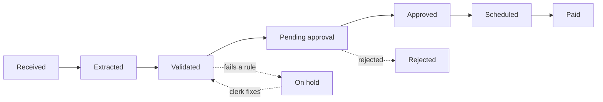

# InvoiceFlow

AI-powered accounts payable for GST invoices.

Finance teams receive hundreds of supplier invoices a month as PDFs and scans. Today an AP clerk types each one in by hand, checks the GST maths, matches it against the purchase order, chases approvers and schedules the payment. It is slow and error-prone: duplicate invoices get paid twice, a wrong GSTIN or tax split loses input tax credit, and late payments damage supplier relationships. InvoiceFlow automates this work. AI reads the invoice, rules check it, the right people approve it, and payment is scheduled on time.

## Who uses it

| Role | What they do |
|---|---|
| Vendor | Uploads invoices as PDFs and tracks their payment status. |
| AP clerk | Reviews the extracted data, fixes errors, resolves exceptions such as PO mismatches, and schedules payments. |
| Approver | Approves or rejects invoices for their department, up to their limit. Invoices above ₹1 lakh need two approvers. |
| Admin | Manages users and roles, the approval matrix, vendor records, tax rates and validation tolerances. Admins cannot approve invoices (separation of duties). |

## Invoice lifecycle

## Validation rules

- **Duplicates:** same supplier GSTIN, invoice number and financial year
- **GSTIN:** format and checksum
- **GST maths:** CGST + SGST within a state, IGST between states
- **3-way match:** purchase order, goods receipt and invoice agree within tolerance

## What AI does

- **Extraction:** reads the PDF and fills in supplier, GSTIN, invoice number and date, PO number, line items with HSN codes, taxes and totals.
- **Contract checks:** finds the vendor's contract and flags invoices that charge more than the agreed rate or use different payment terms.
- **AP assistant:** answers questions such as "Which invoices from vendor X are overdue?" and suggests actions that a person confirms.

## Tech stack

- **Backend:** .NET 10, ASP.NET Core, EF Core, SQL Server
- **Frontend:** Next.js, React, TypeScript
- **AI:** Microsoft Foundry, Azure AI Search
- **Cloud:** Azure Container Apps, GitHub Actions

## Status

Part 1 of 2: modular monolith, in progress. Part 2 splits it into microservices that communicate through Kafka.

All test data is synthetic. No real invoices or company data are used.
