# InvoiceFlow: Architecture

How InvoiceFlow is put together: which project and file owns what, who may talk to whom, and how the app is wired. For the ideas behind each piece, see [topics.md](topics.md). Topic numbers are given as *(T18)*.

> **State:** after Week 2 (commit `26d74ce`). Update this file when the structure changes.

## Contents

**Part A: Structure** (this part)

1. [The big picture](#1-the-big-picture)
2. [Projects and references](#2-projects-and-references)
3. [Who may talk to whom](#3-who-may-talk-to-whom)
4. [Inside the Host](#4-inside-the-host-invoiceflowapi)
5. [Inside the Intake module](#5-inside-the-intake-module)
6. [Inside the Approval module](#6-inside-the-approval-module)
7. [SharedKernel](#7-sharedkernel)
8. [The empty modules](#8-the-empty-modules)
9. [Tests](#9-tests)
10. [Wiring: DI registrations and lifetimes](#10-wiring-di-registrations-and-lifetimes)
11. [Configuration: who owns which section](#11-configuration-who-owns-which-section)
12. [Where does new code go?](#12-where-does-new-code-go)
13. [Structure notes](#13-structure-notes)

**Part B: How it runs**

14. [Startup](#14-startup)
15. [The request pipeline](#15-the-request-pipeline)
16. [The business journey today](#16-the-business-journey-today)
17. [Flow: upload a file](#17-flow-upload-a-file)
18. [Flow: submit an invoice](#18-flow-submit-an-invoice)
19. [Flow: create an approval request](#19-flow-create-an-approval-request)
20. [Flow: approve](#20-flow-approve)
21. [When things go wrong](#21-when-things-go-wrong)
22. [Design decisions and why](#22-design-decisions-and-why)
23. [Known gaps](#23-known-gaps)

---

## 1. The big picture

InvoiceFlow is a **modular monolith** *(T18)*: one app, one process, one deployment, split inside into modules with strict boundaries.

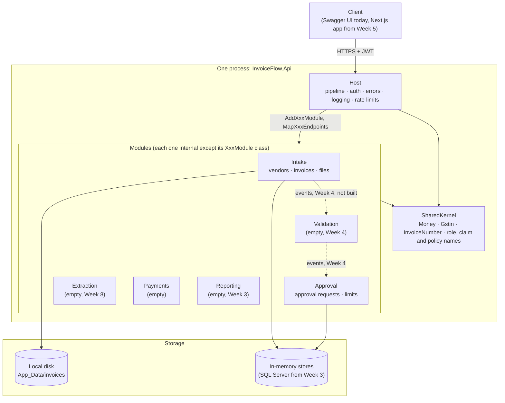

**Read it like this:**

- Requests enter through the **Host**, which owns everything every request needs: middleware, authentication, error handling, logging and rate limiting.
- The Host knows each module only by its **two public methods**: `AddXxxModule` (register services) and `MapXxxEndpoints` (register URLs).
- Modules **never call each other**. Today they don't need to. From Week 4 they'll communicate through **events** (dotted lines), never direct calls.
- Everyone may use **SharedKernel**, and SharedKernel uses no one.

---

## 2. Projects and references

There are 15 projects. An arrow means "has a `ProjectReference` to".

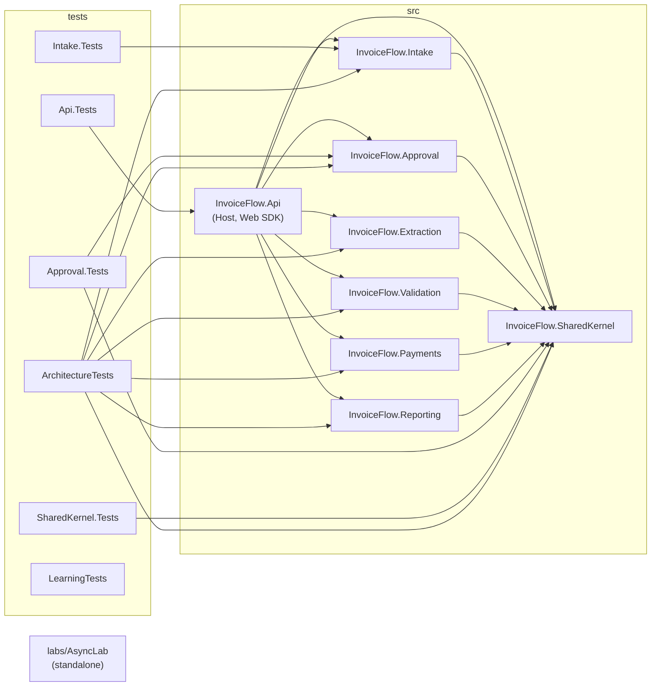

`LearningTests` and `AsyncLab` reference no InvoiceFlow project. They exist to learn how .NET behaves *(T9, T12)*.

| Project | SDK / framework | Packages | Notes |
|---|---|---|---|
| `InvoiceFlow.Api` | Web SDK | JwtBearer, OpenApi, Serilog.AspNetCore, Serilog.Formatting.Compact, Swashbuckle SwaggerUI | The only executable. Holds `UserSecretsId` |
| `InvoiceFlow.Intake` | Class library + `Microsoft.AspNetCore.App` | FluentValidation | `InternalsVisibleTo` Intake.Tests |
| `InvoiceFlow.Approval` | Class library + `Microsoft.AspNetCore.App` | none | `InternalsVisibleTo` Approval.Tests |
| Extraction, Validation, Payments, Reporting | Class library + `Microsoft.AspNetCore.App` | none | Registration method only |
| `InvoiceFlow.SharedKernel` | Plain class library | none | **No ASP.NET Core**, enforced by an architecture test |

Every module has a `FrameworkReference` to `Microsoft.AspNetCore.App`. That's what lets a class library use `MapPost`, `IResult`, `IFormFile` and authorization types without being a web project itself.

Settings every project shares come from [Directory.Build.props](../Directory.Build.props) *(T1)*.

---

## 3. Who may talk to whom

Rows are the caller, columns the callee.

| Caller ↓ / may use → | Host | Same module's internals | Another module | SharedKernel | ASP.NET Core |
|---|---|---|---|---|---|
| **Host** | ✅ | ❌ only `XxxModule` methods | – | ✅ | ✅ |
| **A module** | ❌ | ✅ | ❌ | ✅ | ✅ |
| **SharedKernel** | ❌ | – | ❌ | ✅ | ❌ |
| **A module's test project** | ❌ | ✅ via `InternalsVisibleTo` | ❌ | ✅ | ✅ |

**How each rule is enforced:**

| Rule | Enforced by | What happens if broken |
|---|---|---|
| A module can't see another module's types | No `ProjectReference` between modules | Compile error |
| Even with a reference added, modules must not depend on each other | `Module_DoesNotDependOnOtherModules` *(T19)* | Red test |
| Only `XxxModule` is public inside a module | `internal` by default + `Module_OnlyExposesItsModuleClass` | Red test |
| SharedKernel depends on no module and not on ASP.NET Core | `SharedKernel_DoesNotDependOnModulesOrAspNetCore` | Red test |
| The Host can't reach module internals | `internal` | Compile error |
| Inside a module, Domain doesn't use Endpoints or ASP.NET Core | **Convention only, not tested** | Nothing. See [section 13](#13-structure-notes) |

---

## 4. Inside the Host (`InvoiceFlow.Api`)

The Host owns **cross-cutting concerns**: things every request needs, whichever module handles it.

```text
src/Host/InvoiceFlow.Api/
├── Program.cs                      Composition root: registers services, builds the pipeline, maps module endpoints
├── appsettings.json                Shared config (Serilog JSON, rate limits, Intake, Approval)
├── appsettings.Development.json    Dev overrides (readable logs, JWT issuer and audiences)
├── Properties/launchSettings.json  Ports: http 5146, https 7187
├── Middleware/
│   ├── CorrelationIdMiddleware.cs          (T17) sets X-Correlation-ID and TraceIdentifier
│   ├── CorrelationIdMiddlewareExtensions.cs  app.UseCorrelationId()
│   ├── RequestTimingMiddleware.cs          (T17) logs duration; Warning above 500 ms
│   └── RequestTimingMiddlewareExtensions.cs  app.UseRequestTiming()
├── ErrorHandling/
│   ├── ErrorHandlingExtensions.cs  (T27) AddProblemDetails + correlationId, registers the handler
│   └── GlobalExceptionHandler.cs   (T28) exceptions → 400 or 500 ProblemDetails
├── RateLimiting/
│   ├── RateLimitingExtensions.cs   (T37) "submissions" policy, per-user partition, Retry-After
│   └── SubmissionRateLimitOptions.cs  validated options for the limit
└── OpenApi/
    └── BearerSecuritySchemeTransformer.cs  (T38) adds the JWT "Authorize" button to Swagger UI
```

**Dependencies inside the Host:**

- `Program.cs` uses all four folders and every module's `AddXxxModule` and `MapXxxEndpoints`.
- `GlobalExceptionHandler` uses `CorrelationIdMiddleware.HeaderName`.
- `RateLimitingExtensions` uses `RateLimitPolicies.Submissions` from SharedKernel. The policy *name* is shared because the Intake module applies it with `.RequireRateLimiting(...)`, while the Host defines what it means.

---

## 5. Inside the Intake module

Intake owns **vendors, invoice submission and invoice files**. It is the biggest module so far.

### Folder dependencies

An arrow means "uses".

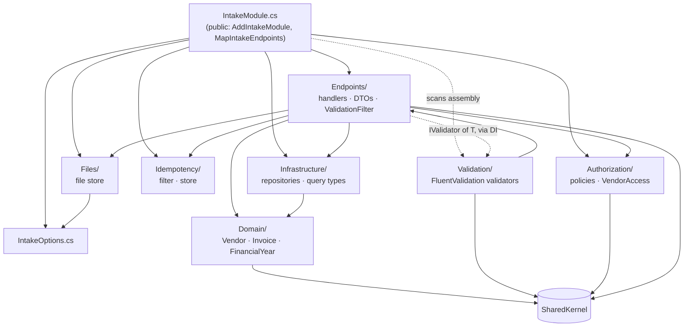

**What the picture shows:**

- **Domain is at the bottom.** It uses only SharedKernel value objects and knows nothing about HTTP, storage or validation.
- **Infrastructure depends on Domain**, never the other way. Repositories store and return `Vendor` and `Invoice`.
- **Endpoints is the coordinator.** It uses everything else, but nothing except `IntakeModule` and `Validation` uses Endpoints.
- **Validation → Endpoints** looks backwards, but it's fine: validators check the *request DTOs*, which live in `Endpoints/`. Endpoints never reference a validator class. `ValidationFilter<T>` asks DI for `IValidator<T>` (dotted line).

### Files

| Folder | File | What it is | Topic |
|---|---|---|---|
| *(root)* | `IntakeModule.cs` | The only public type. Registers services; maps `/api/intake/files`, `/vendors` and `/invoices` | T15 |
| | `IntakeOptions.cs` | `StoragePath`, `MaxUploadSizeBytes` with `[Required]` and `[Range]` | T14 |
| `Endpoints/` | `VendorEndpoints.cs` | `POST /vendors` (register), `GET /vendors/{id}` | T21 |
| | `InvoiceEndpoints.cs` | `POST /invoices` (submit), `GET /invoices/{id}`, `GET /invoices` (paged list) | T21, T35 |
| | `UploadInvoiceFile.cs` | `POST /files`: size, type and signature checks, then save | T11, T38 |
| | `ValidationFilter.cs` | Generic endpoint filter that runs `IValidator<T>` | T23 |
| | `RegisterVendorRequest.cs`, `SubmitInvoiceRequest.cs`, `ListInvoicesRequest.cs` | Request DTOs (nullable fields) | T22 |
| | `VendorResponse.cs`, `InvoiceResponse.cs`, `UploadFileResponse.cs`, `PagedResponse.cs` | Response DTOs | T22 |
| `Validation/` | `RegisterVendorRequestValidator.cs`, `SubmitInvoiceRequestValidator.cs`, `ListInvoicesRequestValidator.cs` | One validator per request | T23, T25 |
| `Authorization/` | `IntakePolicies.cs` | Policy names and the roles each allows | T32 |
| | `VendorAccess.cs` | "A vendor may act only for their own `vendor_id`" | T33 |
| `Idempotency/` | `IdempotencyFilter.cs` | Reads `Idempotency-Key`, replays or rejects | T36 |
| | `IIdempotencyStore.cs`, `InMemoryIdempotencyStore.cs` | Per-user key store, 24 h retention | T36 |
| | `IdempotencyOutcome.cs`, `IdempotencyStart.cs` | Result of `TryStart` | T36 |
| `Domain/` | `Vendor.cs` | Entity: name, GSTIN, payment terms | T24 |
| | `Invoice.cs` | Entity: amounts, dates, file, status; checks total = taxable + tax | T24 |
| | `FinancialYear.cs` | April–March year, such as `2026-27` | T24 |
| | `InvoiceStatus.cs` | Only `Received` so far (state machine in Week 4) | T24 |
| `Infrastructure/` | `IVendorRepository.cs`, `InMemoryVendorRepository.cs` | Vendors by ID; unique GSTIN | T26 |
| | `IInvoiceRepository.cs`, `InMemoryInvoiceRepository.cs` | Invoices by ID; unique (vendor, number, financial year); search | T26, T35 |
| | `InvoiceQuery.cs`, `InvoicePage.cs` | Search input and output | T35 |
| `Files/` | `LocalInvoiceFileStore.cs` | `StoredFile` record, `IInvoiceFileStore` interface and the local-disk store, in one file | T10, T11 |

### Endpoints

| Method and route | Policy | Filters | Returns |
|---|---|---|---|
| `POST /api/intake/files` | `SubmitInvoices` + rate limit | none | 201, 400, 429 |
| `POST /api/intake/vendors` | `ManageVendors` | Validation | 201, 400, 409 |
| `GET /api/intake/vendors/{id}` | `ReadVendors` | none | 200, 404 |
| `POST /api/intake/invoices` | `SubmitInvoices` + rate limit | Idempotency, then Validation | 201, 400, 403, 409, 422, 429 |
| `GET /api/intake/invoices/{id}` | `ReadInvoices` | none | 200, 404 |
| `GET /api/intake/invoices` | `ReadInvoices` | Validation | 200, 400, 403 |

"Returns" lists what the handler, its filters and the rate limiter produce. Every endpoint can also return **401** (no or bad token) and **403** (wrong role), from authorization before the handler runs.

---

## 6. Inside the Approval module

Approval owns **approval requests, approvers' decisions and approval limits**.

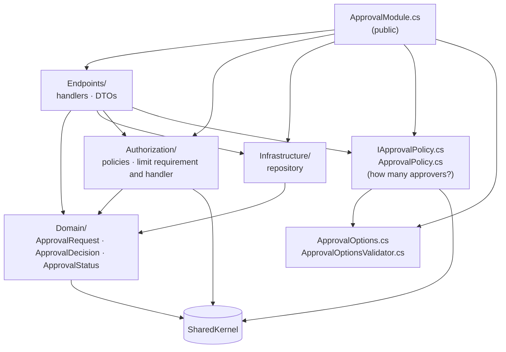

**One notable arrow: Authorization → Domain.** `ApprovalLimitHandler` receives an `ApprovalRequest` as its *resource* so it can compare the amount with the user's limit *(T33)*.

| Folder | File | What it is | Topic |
|---|---|---|---|
| *(root)* | `ApprovalModule.cs` | The only public type. Registers services; maps `/api/approval/requests` | T15 |
| | `ApprovalOptions.cs` | `Tiers` (up-to amount → approvers) and `AboveTopTierApprovers` | T14 |
| | `ApprovalOptionsValidator.cs` | Tiers ascending, approvers never decreasing | T14 |
| | `IApprovalPolicy.cs`, `ApprovalPolicy.cs` | Amount → number of required approvers; live config via `IOptionsMonitor` | T14 |
| `Endpoints/` | `ApprovalRequestEndpoints.cs` | Create, get, approve; hand-written validation in create | T21, T33 |
| | `CreateApprovalRequestRequest.cs`, `ApprovalRequestResponse.cs` | DTOs | T22 |
| `Authorization/` | `ApprovalPolicies.cs` | Policy names, roles, registers the limit handler | T32 |
| | `ApprovalLimitRequirement.cs`, `ApprovalLimitHandler.cs` | Resource-based "amount ≤ `approval_limit` claim" | T33 |
| `Domain/` | `ApprovalRequest.cs` | Entity: amount, required approvals, decisions; `Approve(...)` enforces the rules | T24 |
| | `ApprovalDecision.cs`, `ApprovalStatus.cs` | Who approved when; `Pending` or `Approved` | T24 |
| `Infrastructure/` | `IApprovalRequestRepository.cs`, `InMemoryApprovalRequestRepository.cs` | By ID; one request per invoice | T26 |

| Method and route | Policy | Returns |
|---|---|---|
| `POST /api/approval/requests` | `CreateRequests` (ApClerk) | 201, 400, 409 |
| `GET /api/approval/requests/{id}` | `ReadRequests` | 200, 404 |
| `POST /api/approval/requests/{id}/approve` | `Approve` (Approver) + `WithinApprovalLimit` inside the handler | 200, 403, 404, 409 |

---

## 7. SharedKernel

Small, stable building blocks that every module and the Host agree on *(T18)*.

```text
src/SharedKernel/InvoiceFlow.SharedKernel/
├── ValueObjects/
│   ├── Money.cs           (T7) decimal amount + currency, rounding, en-IN formatting
│   ├── Gstin.cs           (T3, T6) GSTIN with checksum, StateCode, Pan, IsSameState
│   └── InvoiceNumber.cs   (T3) 1–16 of A–Z, 0–9, '/', '-'
├── Security/
│   ├── AppRoles.cs        Vendor, ApClerk, Approver, Admin
│   └── AppClaims.cs       vendor_id, approval_limit
└── Http/
    └── RateLimitPolicies.cs  the "submissions" policy name
```

**The test for "does it belong here?":** at least two projects need it, it has no module's business logic, and it needs no ASP.NET Core. `Http/RateLimitPolicies.cs` holds only a string constant, so it passes the last rule even though its name says Http.

---

## 8. The empty modules

| Module | Contents today | Fills up in |
|---|---|---|
| `Extraction` | `AddExtractionModule` that returns `services` | Week 8: AI reads the uploaded PDF |
| `Validation` | `AddValidationModule` | Week 4: rules engine (duplicates, GSTIN, GST maths, 3-way match) and the `InvoiceValidated` event |
| `Payments` | `AddPaymentsModule` | Payment scheduling after approval (Part 1, later weeks) |
| `Reporting` | `AddReportingModule` | Week 3: the invoice aging report |

They exist already so that the Host wiring, project references and architecture tests cover them from day one.

---

## 9. Tests

252 tests across six projects. Each module's test folders mirror the module's folders.

| Project | Tests | References | What it covers |
|---|---|---|---|
| `SharedKernel.Tests` | 51 | SharedKernel | `ValueObjects/`: Money, Gstin, InvoiceNumber |
| `Intake.Tests` | 124 | Intake (+ `FakeTimeProvider`) | `Authorization/`, `Domain/`, `Endpoints/` (upload), `Files/`, `Idempotency/`, `Infrastructure/`, `Validation/` |
| `Approval.Tests` | 46 | Approval, SharedKernel | `ApprovalPolicyTests` (tiers and options), `Authorization/`, `Domain/`, `Infrastructure/` |
| `Api.Tests` | 13 | Api | `ErrorHandling/`, `Middleware/` (correlation ID), `RateLimiting/` (partition key) |
| `ArchitectureTests` | 13 | All modules + SharedKernel | Module boundaries *(T19)* |
| `LearningTests` | 5 | none (DI package only) | DI lifetimes and captive dependencies *(T12, T13)* |

**Not covered yet (Week 4):** the submit, approve and vendor endpoints have no tests that go through HTTP. Integration tests with `WebApplicationFactory` will add them.

---

## 10. Wiring: DI registrations and lifetimes

Everything is registered once at startup. This table shows *who registers what* and *how long it lives* *(T12–T15)*.

| Registered by | Service → implementation | Lifetime | Why that lifetime |
|---|---|---|---|
| **Host** `Program.cs` | `TimeProvider` → `TimeProvider.System` | Singleton | One clock for the app |
| | `IExceptionHandler` → `GlobalExceptionHandler` | Singleton | Stateless |
| | ProblemDetails, OpenAPI, Serilog, JWT bearer, authorization (+ fallback), rate limiter | Framework-managed | |
| **Intake** `AddIntakeModule` | `IntakeOptions` (validated on start) | Options | |
| | `IInvoiceFileStore` → `LocalInvoiceFileStore` | Singleton | Stateless apart from the root path |
| | `IVendorRepository`, `IInvoiceRepository` → in-memory | **Singleton** | Must be: the data lives in the object |
| | `IIdempotencyStore` → `InMemoryIdempotencyStore` | **Singleton** | Same reason |
| | All `IValidator<T>` (assembly scan) | Scoped | FluentValidation's default |
| | Intake policies | Options | |
| **Approval** `AddApprovalModule` | `IValidateOptions<ApprovalOptions>` → `ApprovalOptionsValidator` | Singleton | |
| | `ApprovalOptions` (validated on start, unknown keys are errors) | Options | |
| | `IApprovalPolicy` → `ApprovalPolicy` | Singleton | Reads live config via `IOptionsMonitor` |
| | `IApprovalRequestRepository` → in-memory | **Singleton** | The data lives in the object |
| | `IAuthorizationHandler` → `ApprovalLimitHandler` | Singleton | Stateless |
| | Approval policies | Options | |
| **Per endpoint** (`AddEndpointFilter<T>`) | `ValidationFilter<T>`, `IdempotencyFilter<T>` | Created per request from request services | So a filter can take the scoped validator safely |

**Week 3 warning:** the EF Core `DbContext` will be **scoped**. Every singleton above that starts needing the database (repositories, idempotency store) must become scoped too, or it becomes a captive dependency *(T13)*.

---

## 11. Configuration: who owns which section

| Section | Bound to | Owned by | Validated |
|---|---|---|---|
| `Serilog` | Serilog config (`ReadFrom.Configuration`) | Host | No |
| `RateLimiting:Submissions` | `SubmissionRateLimitOptions` | Host | `[Range]`, on start |
| `Authentication:Schemes:Bearer` (Development file) | JWT bearer options | Host | By the framework |
| `Intake` | `IntakeOptions` | Intake | `[Required]` and `[Range]`, on start |
| `Approval` | `ApprovalOptions` | Approval | `ApprovalOptionsValidator`, on start; unknown keys fail |
| `AllowedHosts` | Host filtering | Framework | |
| User secrets (`UserSecretsId` in Api.csproj) | JWT signing keys from `dotnet user-jwts` | Developer machine only | |

**Rule:** a module reads only its own section. It receives `IConfiguration` in `AddXxxModule` and binds `GetSection(XxxOptions.SectionName)`.

---

## 12. Where does new code go?

| You're adding… | Put it in | Example |
|---|---|---|
| A new endpoint | `Modules/<Module>/Endpoints/`, mapped from that module's `MapXxxEndpoints` | `GET /invoices/{id}/file` |
| A request or response shape | `Endpoints/` as an `internal sealed record` | `RejectInvoiceRequest` |
| Input rules for a request | `Validation/` as an `AbstractValidator<T>` (found automatically) | |
| A business rule about one entity | The entity's method or factory in `Domain/` | `Invoice.MarkValidated()` |
| Storage | Interface + implementation in `Infrastructure/`, registered in `AddXxxModule` | `EfInvoiceRepository` in Week 3 |
| Who may do it | `Authorization/`: a policy or a handler | |
| Something every request needs (headers, logging, error shape) | Host: `Middleware/` or a Host extension | |
| A value used by two or more modules, with no ASP.NET Core | SharedKernel | `Percentage` for tax rates |
| Something module A needs from module B | **Not a reference.** An event (Week 4), or ask whether it belongs in SharedKernel | Approval needs the invoice amount → `InvoiceValidated` event |
| Settings | An `XxxOptions` class in the module, validated on start, plus a section in `appsettings.json` | |

---

## 13. Structure notes

Things that don't fully match the rest of the structure. None of them is a bug. Fix them when you next touch the file.

1. **[`Files/LocalInvoiceFileStore.cs`](../src/Modules/Intake/InvoiceFlow.Intake/Files/LocalInvoiceFileStore.cs) holds three types:** `StoredFile`, `IInvoiceFileStore` and `LocalInvoiceFileStore`. Every other folder has one type per file (see `Infrastructure/`). Split it when Blob Storage arrives (Week 7) and a second implementation appears.
2. **Approval's policy classes sit at the module root.** `IApprovalPolicy` and `ApprovalPolicy` are a business rule (amount → approvers), but they aren't in `Domain/`. Intake keeps only the module class and options at the root. Moving them into `Domain/` (or a `Policies/` folder) would make both modules read the same way.
3. **Two things are called "Validation":** the `Intake/Validation/` folder (request validators) and the `InvoiceFlow.Validation` module (business rules engine, Week 4). They do different jobs. Keep that in mind when searching, and be careful when naming new types.
4. **The rules *inside* a module aren't tested.** "Domain uses only SharedKernel" and "Infrastructure doesn't use Endpoints" hold today, but only by habit. A NetArchTest rule per module (for example, `*.Domain` must not depend on `Microsoft.AspNetCore` or `*.Endpoints`) would protect them when the team, or the code, grows. Worth adding with the Week 4 tests.
5. **Approval validates by hand** in `CreateRequest` while Intake uses FluentValidation. This is known, and the endpoint is replaced by an event in Week 4.

---

# Part B: How it runs

## 14. Startup

What happens between `dotnet run` and the first request, all in [Program.cs](../src/Host/InvoiceFlow.Api/Program.cs).

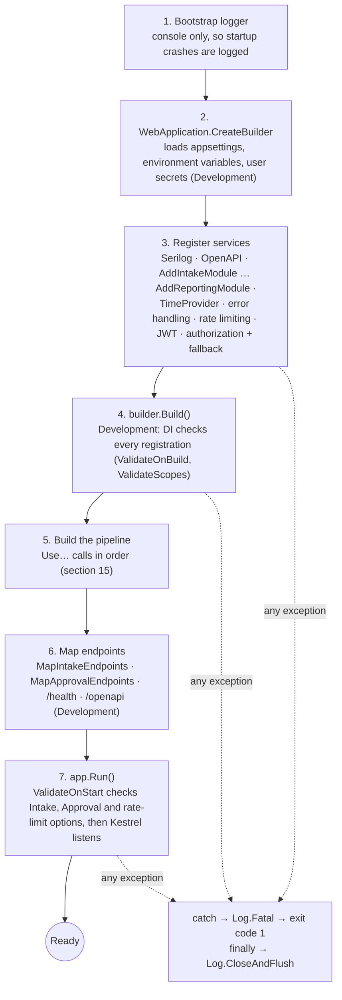

**What can stop the app from starting, on purpose:**

| Problem | Caught at | Topic |
|---|---|---|
| A singleton depends on a scoped service | Step 4 (Development) | T13 |
| `Intake:StoragePath` missing, or upload size out of range | Step 7 | T14 |
| Approval tiers not ascending, or a typo such as `"Teirs"` | Step 7 | T14 |
| Rate limit `PermitLimit` outside 1–1000 | Step 7 | T37 |

Failing at startup is the point: a bad config fails the deploy instead of failing a user's request at 2 AM.

---

## 15. The request pipeline

Every request goes down this list and the response comes back up it *(T16)*. Each step can **end the request early** (last column).

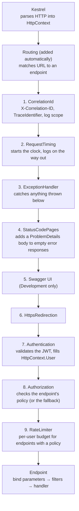

| Step | Ends the request early with | When |
|---|---|---|
| Routing | 404 | No endpoint matches, or a route constraint fails (`/invoices/abc`) |
| HttpsRedirection | 307 | Plain HTTP when HTTPS is configured |
| Authentication | *(never ends it)* | It only sets `User`. An invalid token just leaves the user anonymous |
| Authorization | **401** | Anonymous user on a protected endpoint |
| | **403** | Signed in but the policy fails (wrong role) |
| RateLimiter | **429** + `Retry-After` | Budget used up |
| Binding | **400** | Malformed JSON, missing form file |
| Filters | **400**, 409, 422 or a replay | Validation, idempotency |
| Handler | Anything it returns | Business results |

**On the way back up:**

- **StatusCodePages** fills empty 401, 403, 404 and 429 responses with ProblemDetails *(T27)*.
- **ExceptionHandler** turns exceptions into 400 or 500 *(T28)*.
- **RequestTiming** logs method, path, final status and time.
- **CorrelationId** has already put the header on the response.

---

## 16. The business journey today

What the API can do end to end after Week 2, and which role does each step.

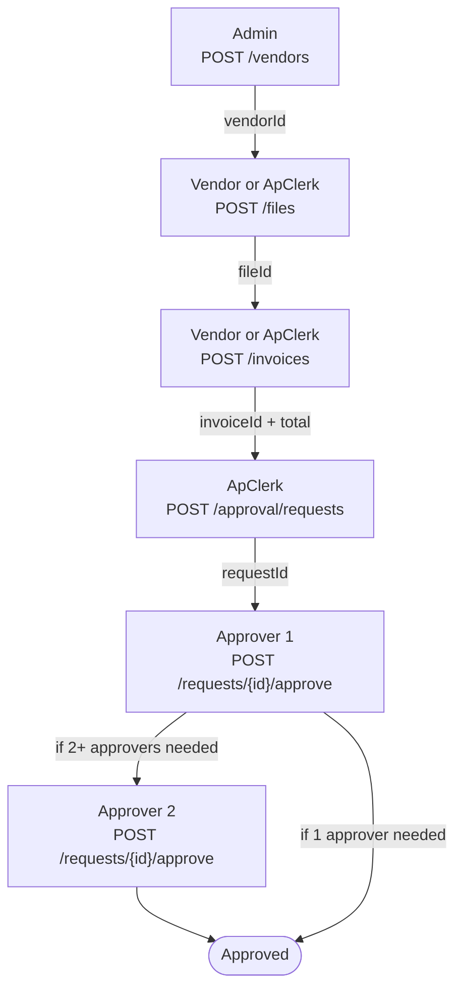

**The manual step in the middle:** the ApClerk copies the invoice ID and total into the approval request by hand. That's the source of gap #13. In Week 4 the arrow from C to D becomes automatic: submit → validate → `InvoiceValidated` event → approval request.

---

## 17. Flow: upload a file

`POST /api/intake/files` (multipart form, field `file`). Code: [UploadInvoiceFile.cs](../src/Modules/Intake/InvoiceFlow.Intake/Endpoints/UploadInvoiceFile.cs), [LocalInvoiceFileStore.cs](../src/Modules/Intake/InvoiceFlow.Intake/Files/LocalInvoiceFileStore.cs).

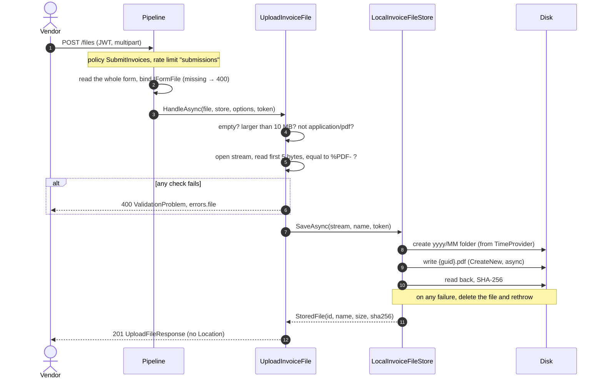

**Why it's built this way:** the client controls the name and the content type, so neither is trusted *(T11)*. Streaming keeps memory low. A GUID file name means no clashes and no path tricks.

---

## 18. Flow: submit an invoice

`POST /api/intake/invoices` (JSON, optional `Idempotency-Key`). Code: `SubmitInvoice` in [InvoiceEndpoints.cs](../src/Modules/Intake/InvoiceFlow.Intake/Endpoints/InvoiceEndpoints.cs).

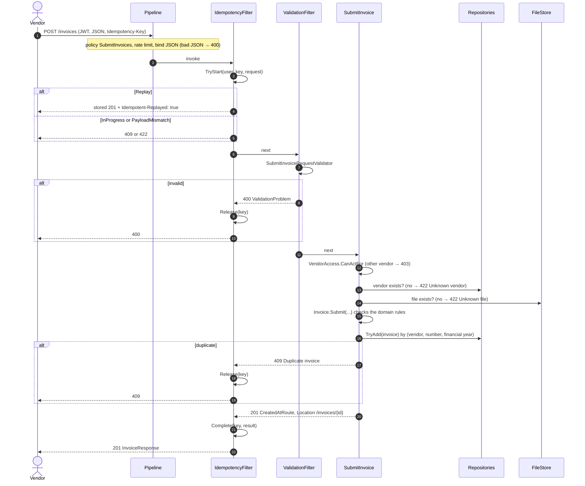

**The checks, in order, and why that order:**

| # | Check | Response | Why here |
|---|---|---|---|
| 1 | Token and role | 401 or 403 | Cheapest, and nothing else should run for strangers |
| 2 | Rate limit | 429 | Before any real work |
| 3 | Idempotency | Replay, 409 or 422 | A retry must return the first answer, even if the data changed since |
| 4 | Field validation | 400 | All input errors at once, before touching data |
| 5 | Vendor ownership | 403 | A vendor submitting for someone else |
| 6 | Vendor and file exist | 422 | Valid shape, but points to nothing |
| 7 | Domain rules | 500 if broken | Safety net. Validation should already have caught it |
| 8 | Duplicate | 409 | Atomic, at the point of saving *(T26)* |

---

## 19. Flow: create an approval request

`POST /api/approval/requests` with `{ invoiceId, amount }`, ApClerk only. Code: `CreateRequest` in [ApprovalRequestEndpoints.cs](../src/Modules/Approval/InvoiceFlow.Approval/Endpoints/ApprovalRequestEndpoints.cs).

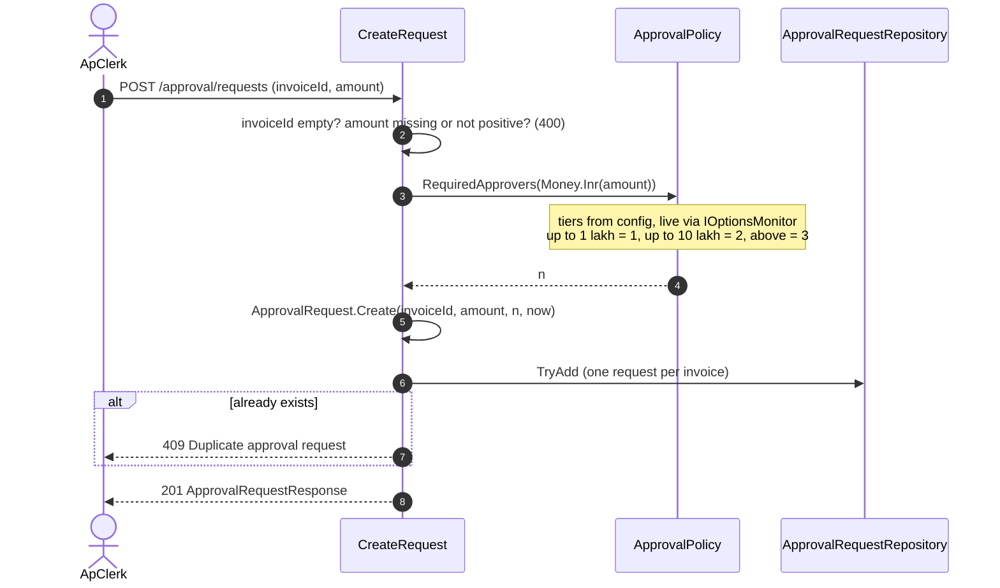

**What's missing, on purpose for now:** nothing checks that the invoice exists or that `amount` equals its total. Approval can't ask Intake, because modules don't call each other. That's gap **#13**, fixed by the `InvoiceValidated` event in Week 4.

---

## 20. Flow: approve

`POST /api/approval/requests/{id}/approve`, Approver only. Code: `Approve` in [ApprovalRequestEndpoints.cs](../src/Modules/Approval/InvoiceFlow.Approval/Endpoints/ApprovalRequestEndpoints.cs), [ApprovalLimitHandler.cs](../src/Modules/Approval/InvoiceFlow.Approval/Authorization/ApprovalLimitHandler.cs).

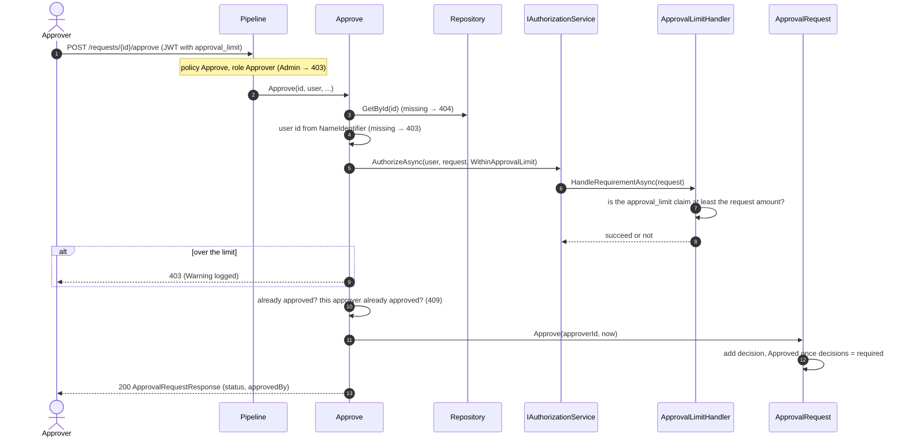

**Two layers of authorization:** the endpoint policy (role) runs *before* the handler. The limit check runs *inside* it, because it needs the loaded request *(T33)*.

---

## 21. When things go wrong

Every failure reaches the client as ProblemDetails with a `correlationId`. This table shows **who produces each one**.

| Situation | Status | Produced by | Body added by |
|---|---|---|---|
| Unknown URL | 404 | Routing | StatusCodePages |
| No or bad token | 401 | Authentication challenge | StatusCodePages |
| Wrong role | 403 | Authorization | StatusCodePages |
| Over the rate limit | 429 | RateLimiter (+ `Retry-After`) | StatusCodePages |
| Malformed JSON, missing file field | 400 | Binding: Development throws `BadHttpRequestException` | GlobalExceptionHandler ("Invalid request") |
| | | Binding: Production sets 400 | StatusCodePages |
| Invalid fields | 400 | ValidationFilter / upload handler | `ValidationProblem` (with `errors`) |
| Business rule (duplicate, unknown vendor, already approved…) | 404, 409, 422 | Handler: `TypedResults.Problem` | The result itself |
| Ownership or approval limit | 403 | Handler: `TypedResults.Forbid()` | StatusCodePages |
| A bug | 500 | Any exception | GlobalExceptionHandler, generic title, details only in the log |

**How the correlation ID survives all of these:**

1. The middleware sets the header and `TraceIdentifier` at the start.
2. `CustomizeProblemDetails` copies `TraceIdentifier` into every ProblemDetails body.
3. The exception handler clears the response headers, so `GlobalExceptionHandler` puts the correlation header back.

---

## 22. Design decisions and why

| Decision | Why | What we gave up / when to revisit |
|---|---|---|
| **Modular monolith** before microservices | Clean boundaries without network calls, distributed data or complex deploys *(T18)* | Revisit in Part 2 (Week 13+), when a module needs to scale or deploy on its own |
| **Only `XxxModule` is public**, checked by tests | The compiler and tests enforce boundaries, not just code review *(T19)* | Test projects need `InternalsVisibleTo` |
| **Value objects in SharedKernel** | GSTIN, money and invoice numbers mean the same thing in every module *(T3)* | SharedKernel must stay small; business logic doesn't go there |
| **Minimal APIs** | Less ceremony, endpoints live inside their module *(T21)* | No `[ApiController]` auto-400, so we added a validation filter |
| **Validation in two layers** | Users get a full list of 400 errors; the domain protects itself from every caller *(T23)* | Some rules exist twice (validator and entity) |
| **ProblemDetails + `correlationId` everywhere** | One error parser on the frontend; support can find logs from what a user sees *(T27)* | |
| **Secure by default** (fallback policy) | A forgotten `.RequireAuthorization` is never "open to the internet" *(T31)* | Public endpoints need an explicit `.AllowAnonymous()` |
| **Policies, not role lists** | Rules change in one place; the approval limit needs a custom requirement anyway *(T32)* | |
| **404 for another vendor's invoice** | Doesn't reveal that the invoice exists *(T33)* | A 404 is a bit less helpful for debugging |
| **Idempotency optional, per user, success-only** | Safe retries without blocking clients that don't send keys; failures can be retried *(T36)* | Without a key, a double click gets 409 Duplicate instead of a replay |
| **Rate limit per user, shared by upload and submit** | One noisy user doesn't hurt others; uploads and submissions are one activity *(T37)* | Per instance until a shared store exists |
| **In-memory stores behind interfaces** | Build the API now, add EF Core in Week 3 without touching endpoints *(T26)* | Data is lost on restart; singletons only |
| **`TimeProvider` everywhere** | Exact tests for dates, expiry and folders *(T25)* | |
| **Files on local disk under GUID names** | Simple and safe for now *(T11)* | Must move to Blob Storage for containers (Week 7) |
| **Approval amount from the client** | Lets Approval be built before events exist | **Temporary:** gap #13, Week 4 |

---

## 23. Known gaps

Everything we know is missing or temporary, and where it gets fixed. Items marked **new** were found while writing this document and weren't on any list before.

| # | Gap | Risk | Fixed in |
|---|---|---|---|
| 1 | Approval amount comes from the client, and the invoice isn't checked (issue **#13**) | An approver with a small limit can approve a large invoice | Week 4: `InvoiceValidated` event |
| 2 | Files have no owner, and one file can be attached to several invoices (issue **#14**) | A vendor could attach someone else's PDF | Week 3: file records in the database |
| 3 | **New:** `ExistsAsync` searches every folder on disk for `{id}.pdf` | Gets slower with every upload | Week 3: look the file up in the database |
| 4 | **New:** the upload size is checked *after* the whole form is received. The real cap is Kestrel's default request limit, about 28.6 MB | A 25 MB upload is fully received, then rejected | Add a request size limit to `/files` (small fix, any time) |
| 5 | **New:** two approve calls at the same moment aren't protected. The in-memory `ApprovalRequest` is changed without a lock, so the same approver could be counted twice | A request marked Approved with one real approver | Week 3: `rowversion` concurrency check |
| 6 | Approving doesn't change the invoice. `InvoiceStatus` has only `Received` | Invoice status never moves | Week 4: invoice state machine and events |
| 7 | All data is in memory | Lost on restart | Week 3: SQL Server |
| 8 | Idempotency keys and rate-limit counters are per instance; expired keys are removed only when reused | Limits multiply with instances; memory grows | Week 3 (database) or Week 11 (Redis) |
| 9 | Submit, approve and vendor endpoints have no HTTP-level tests | Wiring mistakes (filters, policies) aren't caught | Week 4: `WebApplicationFactory` + Testcontainers |
| 10 | `Money.ToString()` needs `en-IN`; the validator needs `Asia/Kolkata` | Fails in small Docker images | Week 7: globalization and tzdata in the image |
| 11 | HTTPS redirection and client IP behind a proxy | Wrong redirects; every user shares the proxy's IP for rate limits | Week 7: forwarded headers |
| 12 | `/health` is hand-written and always says Healthy | The platform can't tell a broken app | Week 7: ASP.NET Core health checks |
| 13 | Structure notes 1–5 | Inconsistency, not risk | When those files are next touched ([section 13](#13-structure-notes)) |

My recommendation is to open GitHub issues for the three **new** gaps (3, 4, 5) so they're tracked like #13 and #14.
